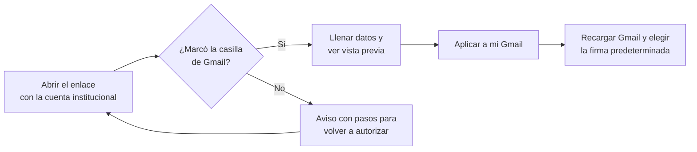
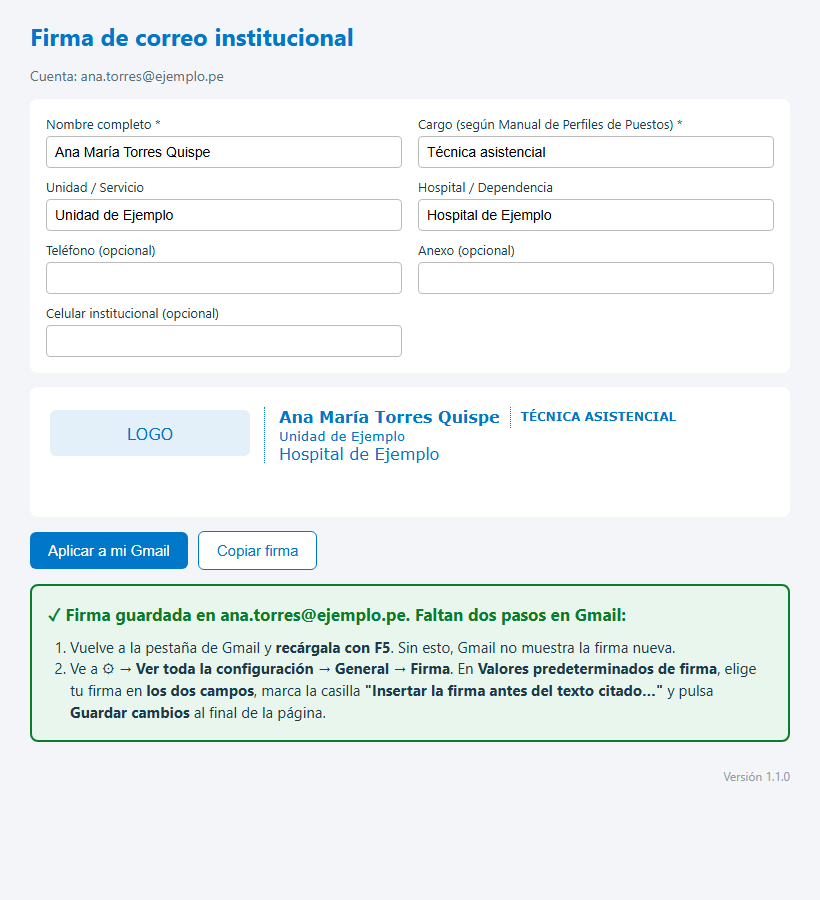
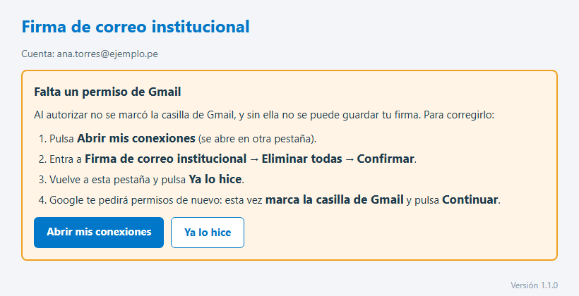

# Firma de Correo Institucional

[](LICENSE)


Aplicación web para que cada persona configure su firma de Gmail con el formato institucional, sin copiar y pegar HTML ni subir imágenes.

Cada usuario abre el enlace con su cuenta de Google Workspace, llena sus datos, ve la vista previa y guarda la firma en su propio Gmail con un clic. Funciona con Apps Script, sin instalar software.

> [!NOTE]
> Recién implementado (noviembre de 2026). No es un desarrollo oficial de ninguna institución.

## Contenido

- [Cómo funciona](#cómo-funciona)
- [Qué hace](#qué-hace)
- [Instalación](#instalación)
- [Uso](#uso)
- [Estructura](#estructura)
- [Versiones](#versiones)
- [Datos](#datos)
- [Licencia](#licencia)

## Cómo funciona



1. La persona abre la aplicación con su cuenta institucional y autoriza el permiso de configuración de Gmail.
2. Llena nombre, cargo, unidad y, si quiere, teléfono, anexo y celular. La vista previa se actualiza mientras escribe.
3. <kbd>Aplicar a mi Gmail</kbd> guarda la firma en su cuenta y le indica los dos pasos que quedan en Gmail.

## Qué hace

- Arma la firma en el servidor, con el mismo formato para todos: logo, nombre, cargo en mayúsculas, unidad, dependencia y teléfonos en Verdana.
- Omite las líneas de los campos opcionales que quedan vacíos.
- Guarda la firma en el Gmail de quien usa la aplicación; no toca la cuenta de nadie más.
- Detecta si al autorizar no se marcó la casilla de Gmail y, en lugar del formulario, muestra cómo corregirlo.
- Ofrece <kbd>Copiar firma</kbd> por si el administrador bloquea los cambios de configuración de Gmail.
- Muestra la versión en uso al pie de la página.



## Instalación

1. Con la cuenta que será propietaria, crear un proyecto en [script.google.com](https://script.google.com).
2. En <kbd>Configuración del proyecto</kbd>, marcar **Mostrar el archivo de manifiesto "appsscript.json"**.
3. Pegar [`src/Code.gs`](src/Code.gs) en `Code.gs`, reemplazar `appsscript.json` por [`src/appsscript.json`](src/appsscript.json) y crear un archivo HTML llamado `Index` con el contenido de [`src/Index.html`](src/Index.html).
4. En <kbd>Configuración del proyecto</kbd> → <kbd>Propiedades del script</kbd>, agregar:

   | Propiedad | Contenido | Obligatoria |
   | --- | --- | --- |
   | `LOGO_URL` | URL pública de la imagen del logo (unos 400 px de ancho) | Sí, para que la firma lleve logo |
   | `HOSPITAL` | Valor inicial del campo Hospital / Dependencia | No |
   | `APP_NOMBRE` | Nombre del proyecto, tal como aparece en las conexiones de la cuenta de Google | No |

5. <kbd>Implementar</kbd> → <kbd>Nueva implementación</kbd> → **Aplicación web**, con *Ejecutar como*: **Usuario que accede a la aplicación web** y *Quién tiene acceso*: **Cualquier usuario de la organización**.

> [!TIP]
> Para publicar cambios sin cambiar el enlace: <kbd>Gestionar implementaciones</kbd> → editar la implementación existente → **Nueva versión**. Una implementación nueva genera otro enlace.

<details>
<summary>Logo desde Google Drive</summary>

Subir la imagen a Drive y compartirla con **Cualquier persona con el enlace**. Si el enlace es `https://drive.google.com/file/d/ID/view`, la URL del logo es `https://lh3.googleusercontent.com/d/ID`. Si la organización no permite compartir fuera de ella, el logo no se verá en los correos que salen a otras organizaciones.

</details>

<details>
<summary>Permisos que solicita la aplicación</summary>

La primera vez, Google muestra el aviso **Unverified** (es una aplicación interna, no publicada) y pide:

- ver la dirección de correo de quien la usa;
- ver y cambiar la configuración de Gmail, para guardar la firma.

El permiso de Gmail aparece como una casilla **sin marcar**. Si se pulsa <kbd>Continuar</kbd> sin marcarla, Google no vuelve a preguntar: la aplicación lo detecta y guía para quitar la conexión desde la cuenta de Google y autorizar de nuevo.



</details>

## Uso

1. Abrir el enlace de la aplicación **desde una computadora**, con la cuenta institucional.
2. Autorizar los permisos marcando la casilla de Gmail.
3. Llenar los datos y pulsar <kbd>Aplicar a mi Gmail</kbd>.
4. Recargar Gmail (<kbd>F5</kbd>) y, en ⚙ → **Ver toda la configuración** → **Firma**, elegir la firma en los dos campos de **Valores predeterminados de firma** y marcar **Insertar la firma antes del texto citado**.

El paso 4 es manual porque la API de Gmail solo permite cambiar el contenido de la firma, no esas opciones.

Las capturas usan datos ficticios. Se regeneran con `python docs/capturas/generar.py`, que carga la página real de `src/Index.html`.

## Estructura

```text
.
├── src
│   ├── Code.gs            Configuración, firma, detección de permisos y guardado en Gmail
│   ├── Index.html         Formulario, vista previa y avisos
│   └── appsscript.json    Manifiesto (servicio de Gmail, permisos y aplicación web)
└── docs                   Capturas con datos ficticios
    └── capturas           Script que genera las capturas
```

## Versiones

Se usa [versionado semántico](https://semver.org/lang/es/): `MAYOR.MENOR.PARCHE`.

| Cambio | Ejemplo | Sube |
| --- | --- | --- |
| Obliga a los usuarios a volver a autorizar o a volver a guardar su firma | Un permiso nuevo o un formato de firma distinto | MAYOR |
| Función nueva o cambio visible que no exige hacer nada | Un aviso nuevo en la página | MENOR |
| Corrección sin funciones nuevas | Un texto mal escrito | PARCHE |

Los cambios de cada versión están en [Releases](../../releases).

## Datos

La aplicación no guarda datos: lo que se escribe en el formulario solo se usa para armar la firma y queda en el Gmail de cada persona.

## Licencia

[MIT](LICENSE)
